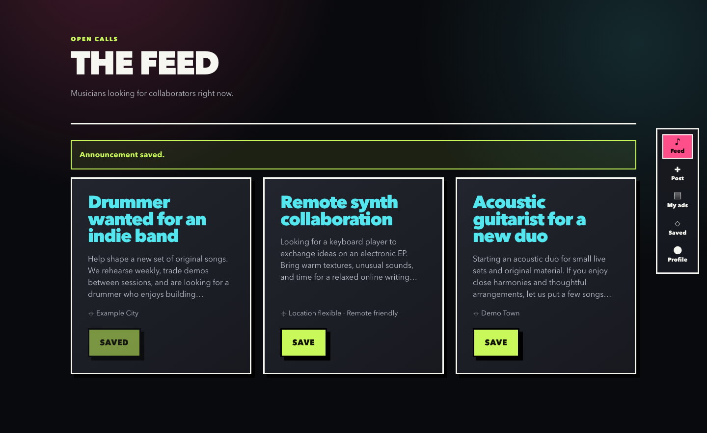

# Every.music

[](https://github.com/mbianchidev/every-music/actions/workflows/ci.yml)

[Quickstart](#quick-start-with-docker-compose) | [Documentation](docs/README.md) | [Build/download](docs/releases.md) | [Report a bug](https://github.com/mbianchidev/every-music/issues/new?template=bug_report.md) | [Roadmap](docs/main.md)

[](docs/images/every-music-feed.png)

*Current web feed connected to a local API and PostgreSQL with synthetic accounts and announcements. Select the image to view it at full resolution.*

Every.music is a self-hosted application for musicians looking for band members and collaborators. Publish open calls, browse opportunities, and build a musician profile using a React web client backed by a Fastify API and PostgreSQL.

## Contents

- [Quick start](#quick-start-with-docker-compose)
- [Why Every.music](#why-everymusic)
- [How it works](#how-it-works)
- [Get started and configuration](#get-started-and-configuration)
- [Implemented features and limitations](#implemented-features)
- [Documentation](#documentation)
- [AI policy](#ai-policy)
- [Contributing](#contributing)
- [Security](#security)
- [License](#license)

## Quick start with Docker Compose

You need Git with GitHub SSH access for the clone command, a running Docker engine with Compose v2, and working authenticated SMTP credentials for account verification and password resets. Host installations of Node.js, PostgreSQL, and Rust are not needed for this setup. Commands below use a POSIX shell.

```bash
git clone git@github.com:mbianchidev/every-music.git
cd every-music
cp .env.example .env
```

Edit `.env` before starting:

- Replace `POSTGRES_PASSWORD` with a strong password.
- Set `CIPHER_PRIMARY_KEY` and `CIPHER_REFRESH_KEY` to **different random values of at least 32 characters**.
- Configure `MAIL_GATEWAY`, `MAIL_PORT`, `MAIL_IDENTITY`, `MAIL_CREDENTIAL`, and `MAIL_SENDER_ALIAS` for your SMTP service. The example credentials do not send mail.
- Keep `http://localhost` first in `PORTAL_ORIGINS` for this setup. Verification and password-reset links use the first configured origin.

Do not commit `.env`. Build and start the stack:

```bash
docker compose build --no-cache
docker compose up -d
docker compose ps
curl --fail http://127.0.0.1:8080/health/ready
curl --fail http://localhost/healthz
```

All three services should become healthy. The API readiness response includes `"status":"ready"`; the web probe returns `ok`.

| Service | Default local address |
|---|---|
| Web app | <http://localhost> |
| API base URL | `http://localhost:8080/realm` |
| API readiness | <http://127.0.0.1:8080/health/ready> |
| PostgreSQL | `127.0.0.1:5432` |

Compose initializes a new database volume with the schema and instrument/genre catalogs. The API container applies migrations before accepting traffic. The volume persists across restarts; there are no seeded demo accounts or announcements.

### First use

1. Open <http://localhost> and create an account. Passwords need at least eight characters, uppercase, lowercase, and a number.
2. Follow the verification link in your email, then sign in.
3. Open your profile and fill in your artist name, first and last name, city, and biography.
4. Publish an announcement, browse the feed, and save opportunities. Use the navigation to manage your own announcements and bookmarks.

**Email troubleshooting:** readiness checks PostgreSQL, not SMTP. Registration remains saved if delivery fails, but unverified accounts cannot sign in. See [troubleshooting](docs/usage.md#troubleshooting) for resend/configuration steps.

## Why Every.music

Keep your musician profile, open calls, and bookmarked opportunities in one place. Announcements describe the collaborator you need, including whether remote collaboration is welcome. Self-hosting keeps the deployment and database under your control, at the cost of operating the API, PostgreSQL, and SMTP.

## How it works

The React client calls the Fastify API under `/realm`; the API stores accounts, profiles, announcements, and bookmarks in PostgreSQL. Compose runs the database, API, and nginx web server together. The same client is wrapped by Tauri for native builds.

### Stack and platforms

| Component | Implementation |
|---|---|
| API | Fastify 5 on Node.js 22 |
| Database | PostgreSQL 16 with SQL migrations |
| Web client | React 19 and Vite 8 |
| Native shell | Tauri 2, sharing the web client |
| Local deployment | Docker Compose, with nginx serving the web client and proxying the API |

The web app runs in a browser. The Tauri shell targets Linux, macOS, and Windows; Android and iOS require additional platform setup. Native clients still need a running API and database, not just the application bundle.

The [architecture guide](docs/architecture.md) explains request flow, repository
boundaries, transactions, token/session behavior, errors, and health checks.
The UI shares labelled forms, keyboard focus, status messages, and reduced-motion
support; see the [accessibility contribution target and checks](ACCESSIBILITY.md).

## Get started and configuration

Use the [installation and usage guide](docs/usage.md) for account recovery,
troubleshooting, upgrades, and data/uninstall behavior. The
[configuration reference](docs/configuration.md) lists every supported setting,
default, and configuration scope.

For development, use Node.js 22.12+, npm, and PostgreSQL 16; follow the
[development guide](docs/development.md) for locked installs, an empty database,
API/client startup, tests, audits, and debugging.

For desktop installers, use the [verified release command or CI artifacts](docs/releases.md).
These are unsigned development builds, not published store releases. Native
clients need an absolute API URL ending in `/realm`, backend CORS, and the Tauri
CSP aligned with that URL. See [desktop/mobile setup](docs/mobile.md) for Rust
and platform SDKs. Android/iOS require separate initialization/signing and are
not packaged by desktop CI.

## Implemented features

- **Accounts:** email/password registration, email verification, password reset, sign-out, and automatic session refresh.
- **Profiles:** edit your artist name, first and last name, city, and biography.
- **Announcements:** browse the feed, publish an open call with a city and remote-collaboration option, and delete your own announcements.
- **Bookmarks:** save announcements and revisit or remove them from the saved list.
- **API capabilities:** filtered profile and announcement searches, instrument and genre catalogs, musical projects, announcement updates and reactions, and optional Google ID-token sign-in. Some of these capabilities are API-only.

### Current limitations

- The current UI has no Google sign-in, profile-search screen, search filters or pagination controls, announcement-editing or reaction controls, or editors for instruments, genres, and musical projects. These capabilities are exposed through the API.
- In-app chat, push notifications, payments/subscriptions, and a media-upload workflow are not implemented. [Product vision](docs/main.md) contains proposed features and historical design ideas, not a list of shipped functionality.
- Native shells do not bundle the backend or provide an offline mode. A reachable API is required.
- Desktop CI provides development artifacts, not signed/notarized public releases. Mobile distribution and cross-platform accessibility still need platform-specific verification.

## Documentation

Start at the [documentation index](docs/README.md): it links user installation,
usage, full configuration, operations, API contracts, architecture, development,
native packaging, and the historical roadmap.

## AI policy

You are responsible for everything you contribute, including AI-assisted code, documentation, and assets. Review and test your contribution, and be able to explain what the code does and why it is needed.

## Contributing

Issues and focused pull requests are welcome. Read [CONTRIBUTING.md](CONTRIBUTING.md)
for setup and review expectations, the [Code of Conduct](CODE_OF_CONDUCT.md) for
participation/reporting, and [ACCESSIBILITY.md](ACCESSIBILITY.md) for UI changes.
Coding agents must read [AGENTS.md](AGENTS.md).

[Report a bug](https://github.com/mbianchidev/every-music/issues/new?template=bug_report.md) or [propose a feature](https://github.com/mbianchidev/every-music/issues/new?template=feature_request.md) using the existing issue templates.

## Security

Report suspected vulnerabilities privately using the [security policy](SECURITY.md), not a public issue. GitHub private vulnerability reporting is enabled for this repository.

## License

Application code is licensed under Apache License 2.0; see [LICENSE](LICENSE).
The [Code of Conduct](CODE_OF_CONDUCT.md#attribution) retains Contributor Covenant's
CC BY-SA 4.0 license. Vendored dependencies retain their own notices.
